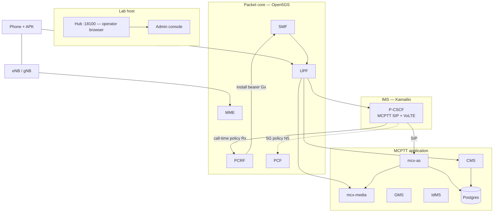
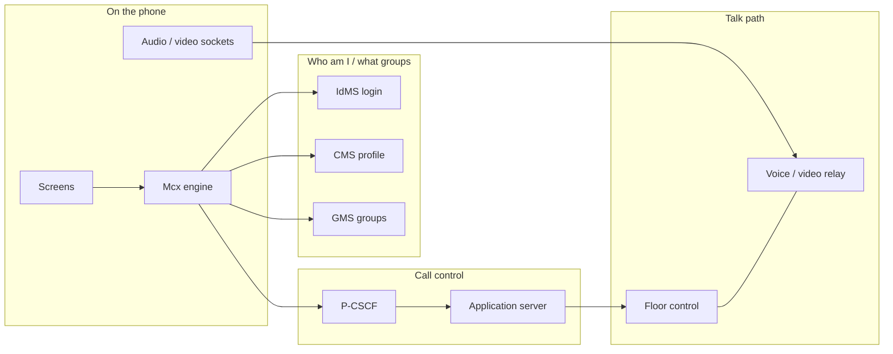
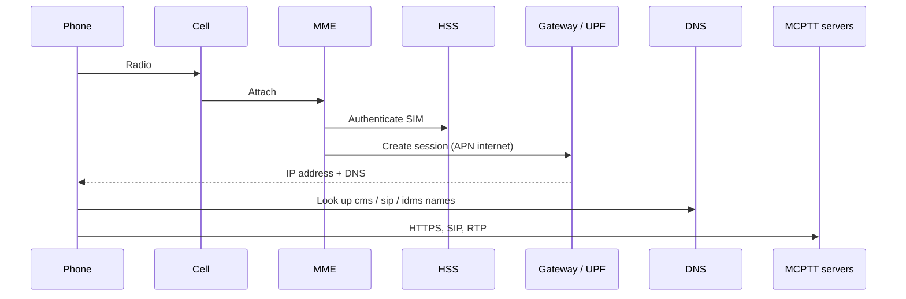
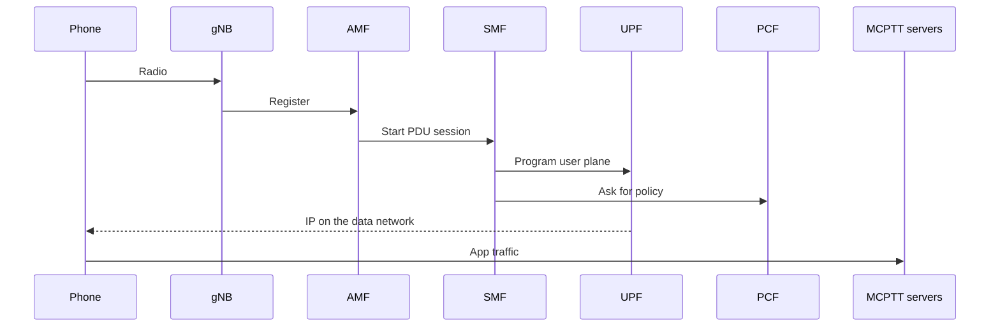
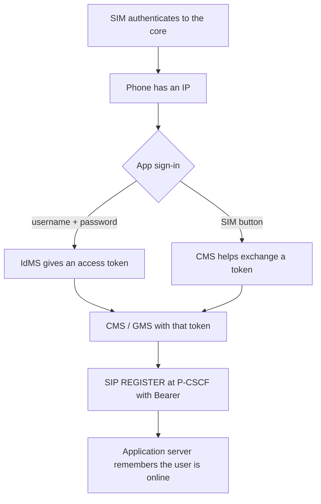
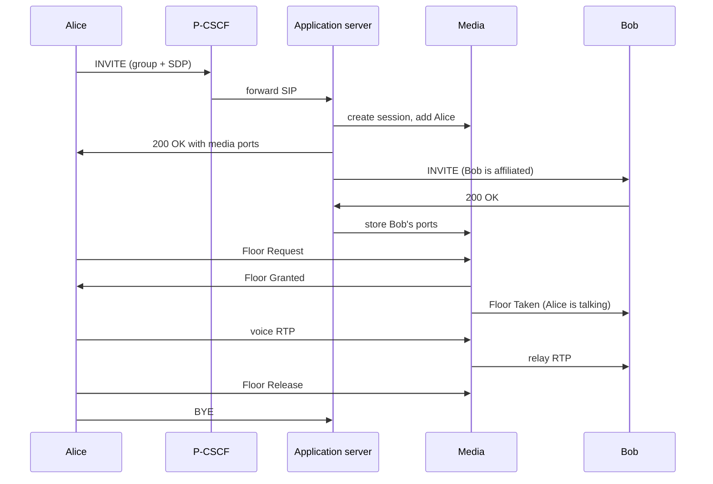
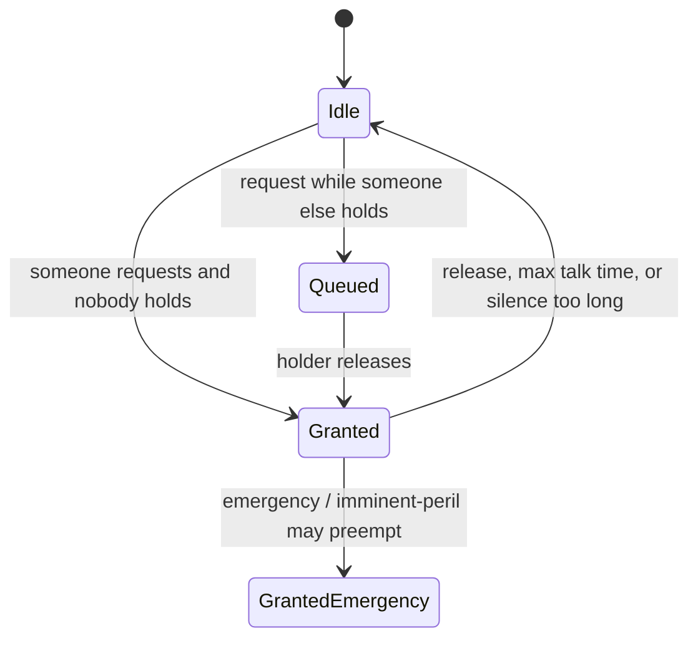
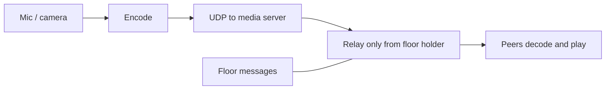
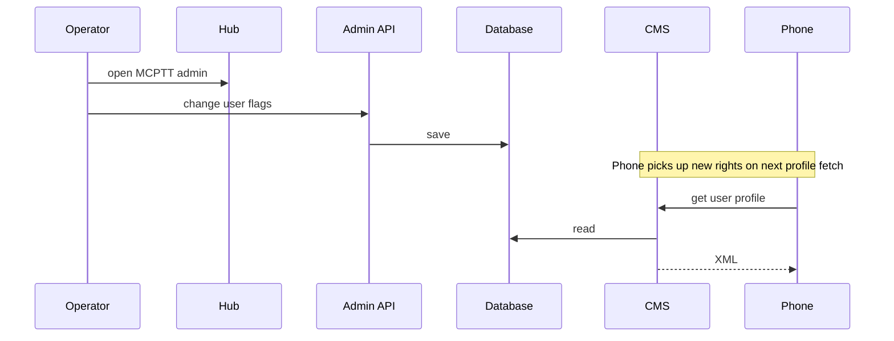
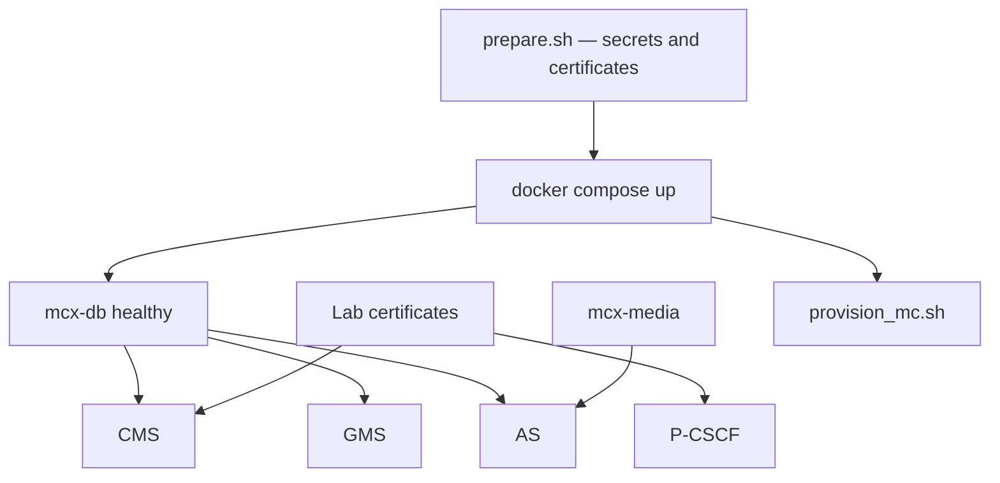

# 02 — System Architecture and Call Flows

This chapter answers one question: **when Alice presses PTT, what actually happens in the network?**

You do not need to memorize every box. Read once for the story, then come back to the diagrams when you debug.

Companion textbook: [01-MCPTT-Master-Handbook.md](01-MCPTT-Master-Handbook.md).

---

## 1. The big picture in everyday words

Think of three layers stacked on top of each other:

1. **Radio + packet core (Open5GS)**  
   The phone attaches to the cell, proves its SIM, and gets an IP address. Without this, the MCPTT app has nowhere to send packets.

2. **Call control (IMS P-CSCF + MCPTT application server)**  
   The app registers and places calls with SIP (the same family of messages VoLTE uses). The first SIP hop is the **P-CSCF**. That proxy forwards MCPTT calls to our **application server** (`mcx-as`), which decides who is in the group call and tells the media server to open ports.

3. **Media (floor + audio/video)**  
   Who may talk is decided by **floor control**. The actual voice/video bytes are **RTP** through `mcx-media`.

On top of that, operators use **Hub** (a browser portal). Hub is *not* part of 3GPP MCPTT — it is just how you configure users and watch the lab.

### Why quality of service matters here

If MCPTT voice ran on the same “best effort” internet bearer as WhatsApp, a busy cell could make PTT choppy. Standards therefore define special **QoS classes** (QCI on 4G, 5QI on 5G) for mission-critical traffic:

| Class | Typical use |
|------:|-------------|
| **65** | MCPTT voice (and related floor media) |
| **67** | MCVideo |
| **69** | MCPTT signalling (SIP) |
| **70** | MCPTT data (CMS, GMS, IdMS, file distribution, …) |
| **1** | Ordinary VoLTE audio (must stay available for normal IMS calls) |

### How this lab asks the core for those classes

**The intended, standards-based way (this is what we build toward in production):**

When a call starts, the **P-CSCF** already sees the SIP/SDP. It tells the policy engine “this session needs MCPTT treatment.”

- On **4G:** P-CSCF → **PCRF** (Diameter **Rx**) → PCRF tells the gateway (**Gx**) → the **SMF/UPF** path installs a **dedicated bearer** with the right QCI.  
- On **5G:** the same idea uses **N5** toward the **PCF**, then **SMF**, then **UPF**.

So we are not inventing a private QoS hack. We are using a normal **3GPP policy and charging control (PCC)** loop, with Open5GS and Kamailio modified so they understand MCPTT application identifiers and those QCIs/5QIs.

**What we do *not* sell as the industrial answer:** pre-loading city-wide packet filters in Mongo (“MC Critical” / `mc-rules`). That can help a lab demo when radio traces are hard, but it is a **temporary fallback**, not the architecture you want to ship.

---

## Diagram A — Boxes on the lab host

**How to read this.** The phone’s traffic reaches MCPTT servers through the **UPF**. Signalling for calls goes **phone → P-CSCF → application server**. When a call needs priority treatment, **P-CSCF talks to PCRF (or PCF on 5G)**, and the core updates the **UPF** so the radio treats those packets as MCPTT QCIs — not as ordinary internet.

---

## Diagram B — What runs inside the phone vs the servers

Floor control and RTP relay live in **one** process (`media_server.py`). CMS and GMS are separate containers from the same software image, started with different roles.

---

## Diagram C — Getting an IP on LTE (before any MCPTT)

Until this finishes, the app cannot register or call.

---

## Diagram D — Same idea on 5G SA

This lab’s day-to-day radio demos are usually **LTE**. 5G SA compose files exist; treat a full BladeRF 5G+MCPTT demo as something you verify when that radio path is up.

---

## Diagram E — Logging in (several keys, one goal)

Cellular attach and app login are **different**. Attach gives IP. Login gives the MCPTT identity token used for CMS and SIP.

---

## Diagram F — A normal group call (Hold to talk)

If Bob presses PTT while Alice still holds the floor, he is **queued** (same group, normal priorities). He does not steal the floor just because his user priority number is higher. Elevating to **emergency** or **imminent peril** is a separate, explicit action.

While this INVITE/SDP is visible at the P-CSCF, the core can open the dedicated MCPTT bearers described in section 1.

---

## Diagram G — Floor states (who may speak)

Implementation: `media_server.py` (`floor_request`, grant, queue, timers).

---

## Diagram H — Audio and video bytes

---

## Diagram I — Operator changes a user in Hub

---

## Diagram J — What must be up before calls work

---

## Trust boundaries (short)

| Boundary | What sits inside | What can go wrong outside |
|----------|------------------|---------------------------|
| Phone ↔ core | Attach and IP | Bad radio, wrong APN |
| Phone ↔ MCPTT apps | TLS to CMS, IdMS, SIP | Missing lab CA on the phone |
| P-CSCF ↔ PCRF | Call-time policy | No dedicated bearer → choppy MCPTT |
| App server ↔ media | Internal HTTP | Signalling works, no audio |

---

## When something breaks

| Failure | What you usually see |
|---------|----------------------|
| Database down | CMS / GMS / AS / admin errors |
| Media down | Call may ring; no talk / no floor |
| P-CSCF down | No SIP register or invite |
| IdMS down | Login fails |
| Missing UE route on media host | One-way or silent RTP |
| Policy path not firing | Call works but no MCPTT QCIs on the radio |

Next: [03-Operator-Runbook.md](03-Operator-Runbook.md).
