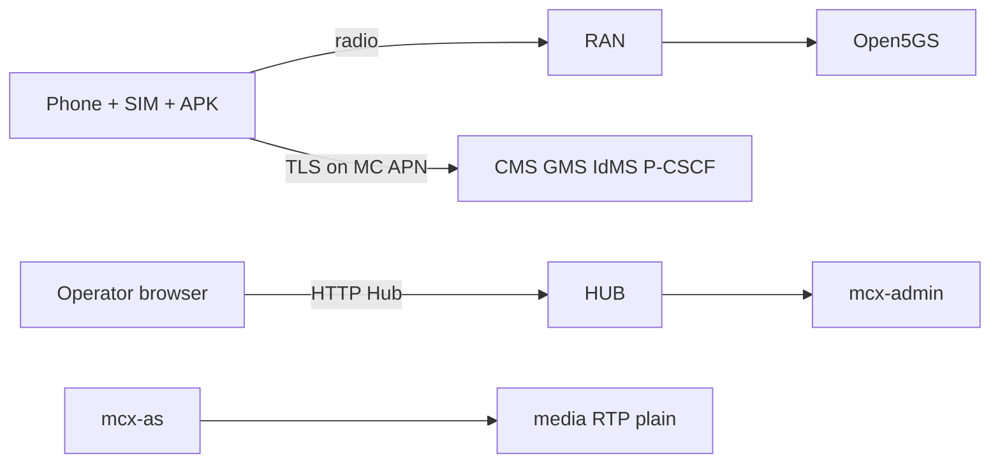

# 09 — Security and Reliability

This lab is built for **demos and engineering learning**. It is **not** a certified mission-critical security product. Read this chapter as an honest map of trust boundaries and known gaps.

---

## 1. Trust boundaries (picture)

| Boundary | What protects it today | Honest gap |
|----------|------------------------|------------|
| SIM ↔ HSS | EPS-AKA | Keep Ki / OPc offline and out of tickets |
| APK ↔ IdMS / CMS | TLS + lab CA | Devices must trust the lab CA; certificate pinning is **not proven** here |
| SIP | TLS to P-CSCF + token introspect | Details live in P-CSCF / AS config |
| Media | **None** (plain RTP) | **Not built:** SRTP / GMK |
| Hub | Shared password | Not SSO to IdMS — lab only |
| Admin API | `MCX_ADMIN_REQUIRE_AUTH=0` in overlay | Open API on the lab network |
| Docker socket | Mounted into some admin/exporter containers | Powerful — treat as host-compromise risk |

---

## 2. How authentication works (layer by layer)

| Layer | Mechanism | Where |
|-------|-----------|-------|
| Cellular | AKA with the SIM | Open5GS / HSS provisioning |
| App user | OAuth password or SIM exchange | IdMS + CMS |
| SIP | Bearer introspect (and related checks) | P-CSCF → AS `/v1/auth/introspect` |
| SIM bind | IMSI allow-list | `sim_bind`, `mc_user_imsi` |
| Hub | Form session cookie | `hub.py` |
| Emergency / peril | CMS boolean flags | DB → XML → phone → AS checks |

---

## 3. Secrets handling

- Live in `.mcptt_env`, compose environment, `/pki/*.key`, and the subscriber database.  
- **Never** commit real values; `prepare.sh` generates lab secrets.  
- In handbooks and tickets, cite **names only**.  
- Rotate lab user passwords with `prepare.sh --rotate-user-passwords`, then recreate IdMS / related services as the overlay README describes.

---

## 4. Authorization highlights

- Group membership is enforced when the application server invites or joins.  
- Emergency and imminent peril each need their own user (and group, for peril) flags.  
- Dispatcher / N6 / monitor modes are product policy fields projected through CMS.  
- Deleting seed users from Admin needs an explicit force confirmation.

---

## 5. Reliability behaviours (what recovers, what dies)

| Mechanism | Behaviour |
|-----------|-----------|
| Presence TTL | Soft-state registrations on the AS expire if not refreshed |
| Floor T2 / hang / RTP inactivity | Media server timers end or revoke talk |
| SIP register refresh | Android schedules REGISTER renewals |
| Hub proxy | Per-request; if upstream is down the iframe looks empty |
| Database loss | CMS / GMS / AS fail closed for directory operations |
| Media restart | Active calls die — sessions are in memory |

---

## 6. Logging hygiene

Logcat and `docker logs` may include MCPTT IDs, IPs, and call IDs — treat shared channels as **sensitive**. Do not log tokens or passwords; report it as a bug if you find them.

---

## 7. Hardening checklist (before anyone claims “production”)

1. Set `MCX_ADMIN_REQUIRE_AUTH=1` and use operator tokens.  
2. Replace shared Hub password with real SSO / MFA.  
3. Remove docker.sock from containers that do not need it.  
4. Implement media protection per the TS 33.180 profile you choose.  
5. Prove IMS-anchored signalling **and** dynamic PCC on air (Create-Bearer / QoS-flow).  
6. Network policies so phones reach only MC VIPs and ports.  
7. Encrypted backups, a secret manager, and shipped audit logs.

**Do not claim production readiness** until the list above is done and tested.

Next: [10 — Labs, glossary, exam](10-Practical-Labs-Glossary-and-Exam.md).
