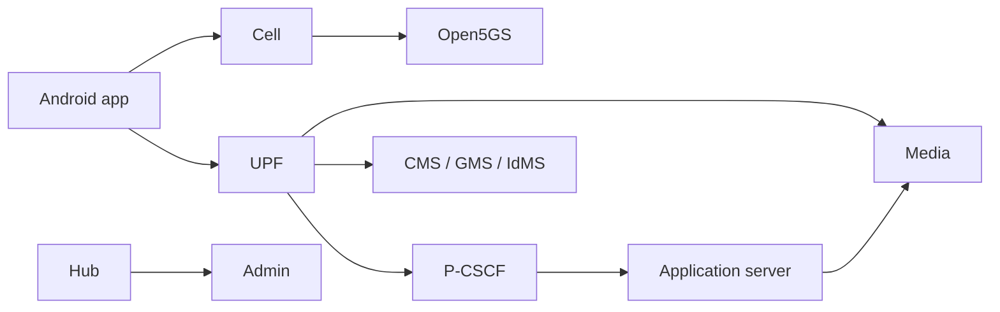

# HPPCN MCPTT Master Handbook

Welcome. This handbook teaches **this lab’s** mission-critical push-to-talk system — from “phone attaches to the cell” through “Alice talks, Bob hears” — using ordinary language first and file paths when you need to verify.

It is written for someone who may be new to cellular cores and MCPTT, but who will operate or defend **this** repository (`MCPTT_Full` / `custom_deployments/mcptt`).

---

## What you will be able to do

After working through the set:

1. Explain what MCPTT is (and what Hub is *not*).  
2. Sketch how radio, core, P-CSCF, application server, and media fit together.  
3. Bring the lab up, check health, and run a two-phone voice demo.  
4. Use Hub and the Android app without guessing what each screen means.  
5. Find configuration knobs without hunting blindly.  
6. Debug “registered but no audio” style failures layer by layer.  
7. Speak carefully about 3GPP: what we implement, what we approximate, what we do not claim.

---

## How claims are tagged

| Tag | Meaning |
|-----|---------|
| **In this repo** | You can open a cited path and see it |
| **Seen on lab** | Observed in logs / UE / HTTP on a running stack |
| **Covered by tests** | Exercised by `mcx-uesim` / acceptance |
| **Inferred** | Fits the architecture; not proven here |
| **Not proven yet** | Needs a radio capture or deeper audit |
| **Not built** | Intentionally absent (e.g. encrypted media) |
| **Out of scope** | Not this lab’s job (e.g. off-network MCPTT) |

This handbook is **not** a 3GPP compliance certificate and **not** a place to paste passwords or SIM keys.

---

## Suggested reading order

1. **This README** — map of the world.  
2. **[01 Textbook](01-MCPTT-Master-Handbook.md)** — networking → LTE/5G → IMS → MCPTT → this stack.  
3. **[02 Architecture & flows](02-System-Architecture-and-Call-Flows.md)** — pictures and call stories.  
4. **[03 Operator runbook](03-Operator-Runbook.md)** — start, provision, verify, recover.  
5. **[04 Hub & Android manual](04-WebUI-and-Android-User-Manual.md)** — buttons and screens.  
6. **[05 Configuration catalogue](05-Configuration-and-Variable-Catalogue.md)** (+ CSV).  
7. **[07 Protocols & ports](07-Protocols-APIs-Ports-and-Data-Models.md)**.  
8. **[06 Standards](06-3GPP-Standards-and-Traceability.md)** (+ CSV) — how we relate to 3GPP.  
9. **[08 Troubleshooting](08-Troubleshooting-and-Observability.md)**.  
10. **[09 Security](09-Security-and-Reliability.md)**.  
11. **[10 Labs & glossary](10-Practical-Labs-Glossary-and-Exam.md)**.  
12. **[11 Inventory appendix](11-Source-Inventory-Appendix.md)** when you need every IP and module.

If you already know LTE attach and SIP, still read chapter 1 and chapter 6 in **01** (what MCPTT is *here*, and how network QoS works).

---

## One-page story of the system

1. The **phone** attaches to lab LTE (or already has a data connection).  
2. It gets an IP (often in `192.168.100.0/24`) and lab DNS. Media servers can reach that IP **without NAT**.  
3. The app logs into **IdMS**, then loads profile/groups from **CMS** / **GMS**.  
4. The app **SIP-registers** at the **P-CSCF** (same IMS front door VoLTE uses), with a Bearer token.  
5. Calls go **phone → P-CSCF → application server (`mcx-as`)**. Floor and RTP go through **`mcx-media`**.  
6. At call time the P-CSCF can ask the **PCRF** (4G) or **PCF** (5G) for mission-critical bearers (classes **65 / 67 / 69 / 70**). That is ordinary 3GPP policy control — see doc **02** §1.  
7. Operators use **Hub** in a browser to open Admin, Grafana, and friends. Hub is a lab portal, not a 3GPP network function.

---

## Document index

| File | What it teaches |
|------|-----------------|
| [01](01-MCPTT-Master-Handbook.md) | Progressive textbook |
| [02](02-System-Architecture-and-Call-Flows.md) | Architecture and call flows |
| [03](03-Operator-Runbook.md) | Day-2 operations |
| [04](04-WebUI-and-Android-User-Manual.md) | Hub + phone UI |
| [05](05-Configuration-and-Variable-Catalogue.md) / [CSV](05-Configuration-and-Variable-Catalogue.csv) | Settings catalogue |
| [06](06-3GPP-Standards-and-Traceability.md) / [CSV](06-Standards-Traceability.csv) | Standards map |
| [07](07-Protocols-APIs-Ports-and-Data-Models.md) | Ports, APIs, schemas |
| [08](08-Troubleshooting-and-Observability.md) | How to debug |
| [09](09-Security-and-Reliability.md) | Trust and lab limits |
| [10](10-Practical-Labs-Glossary-and-Exam.md) | Hands-on + glossary |
| [11](11-Source-Inventory-Appendix.md) | Full inventory |

### Other docs you may still open

- `custom_deployments/mcptt/README.md` — overlay bring-up  
- `docs/mcx-e2e-runbook.md` — BladeRF two-phone demo  
- `docs/adr/` — short decision records for engineers  
- `docs/mcx-ip-port-qos-plan.md` — port/QCI planning notes  

---

## Where the code lives

| Area | Path |
|------|------|
| Compose base | `deploy-all.yaml` |
| MCPTT overlay | `custom_deployments/mcptt/mcptt-overlay.yaml` |
| Open5GS image + patches | `base/`, `base/patches/open5gs/` |
| Kamailio IMS + patches | `ims_base/`, `ims_base/patches/kamailio/` |
| Python MC services | `custom_deployments/mcptt/services/mcxpy/` |
| Hub | `custom_deployments/mcptt/services/hppcn_hub/` |
| Android app | `custom_deployments/mcptt/android/HppcnMcptt/` |
| Database seed | `custom_deployments/mcptt/db/` |
| Certificates | `custom_deployments/mcptt/pki/` |
| Provisioning scripts | `custom_deployments/mcptt/provisioning/` |
| P-CSCF MCPTT routes | `pcscf/route/mcptt.cfg` |

Full IP/service table: [11](11-Source-Inventory-Appendix.md).

---

## Honest “still open” list

1. **Radio proof of call-time QoS** — wiring is in the tree; attach a Create-Bearer / QoS-flow capture from a live demo when you run one.  
2. **Clause-by-clause conformance** — doc 06 maps families; it does not certify the product.  
3. **5G SA + this MCPTT lab on air** — compose can start SA; primary phone demos are still LTE-oriented.  
4. **Off-network / IOPS / LMR** — not built here.  
5. **Encrypted media (SRTP / GMK)** — lab RTP is plain.  
6. **Old Postgres volumes** — new SQL files run only on first DB init; existing volumes may need a manual migration.

---

## Keeping the handbook honest

When you change a call flow or a container role, update the cited paths in the same change. Prefer teaching language; put engineer shorthand in ADRs if needed.

Next: [01 — Master textbook](01-MCPTT-Master-Handbook.md).
